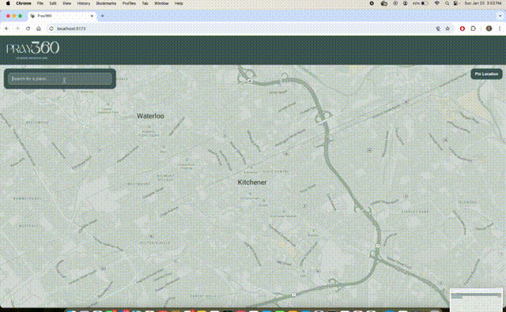

# Pray360 

A community driven platform for discovering and rating prayer/multifaith spaces. Pray360 helps users find suitable places to pray while traveling, at work, or in unfamiliar areas.

## Demo



🎥 [Watch with audio on YouTube](https://www.youtube.com/watch?v=vtsPQ86lR9g)

## Features

### For Non-Buisness Owners
- **Discover Prayer Spaces** - Find nearby mosques, prayer rooms, and community verified prayer spots on an interactive map
- **Search Locations** - Search for addresses, sorted by proximity to your location
- **Pin New Locations** - Add new prayer spaces by pinning locations directly on the map
- **Rate & Review** - Share your experience with ratings and reviews to help the community

### For Business Owners
- **Claim Your Space** - Register as a business owner to manage your prayer space
- **Set Capacity** - Specify how many people can pray at your location
- **Promote Your Space** - Create promotions to attract more visitors

## Tech Stack

### Frontend
- **React 18** with TypeScript
- **Vite** for fast development and building
- **MapTiler** for the interactive map UI

### Backend
- **Node.js**
- **PostgreSQL** for geospatial queries
- **Docker** for database containerization
- **Fastify** for sending HTTP requests

## Getting Started

### Prerequisites
- Node.js 18+
- Docker and Docker Compose
- MapTiler API key

### Installation

1. **Clone the repository**
   ```bash
   git clone https://github.com/hayamahmoudd/pray360.git
   cd pray360
   ``

2. **Start the database**
   ```bash
   docker-compose up -d
   ```

3. **Set up the backend**
   ```bash
   cd backend
   npm install
   cp .env.example .env 
   npm run dev
   ```

4. **Initialize the database**
   ```bash
   curl http://localhost:4000/dev/init
   ```

5. **Set up the frontend**
   ```bash
   cd frontend
   npm install
   cp .env.example .env 
   npm run dev
   ```

## Future Implementation
    - IOS/Andriod Mobile Application in addition to web app
    - Promotions for users who utilize prayer spaces in certain businesses
    - ID Verifcation for all business users 
    - See how far the closest prayer spot is from your current location
